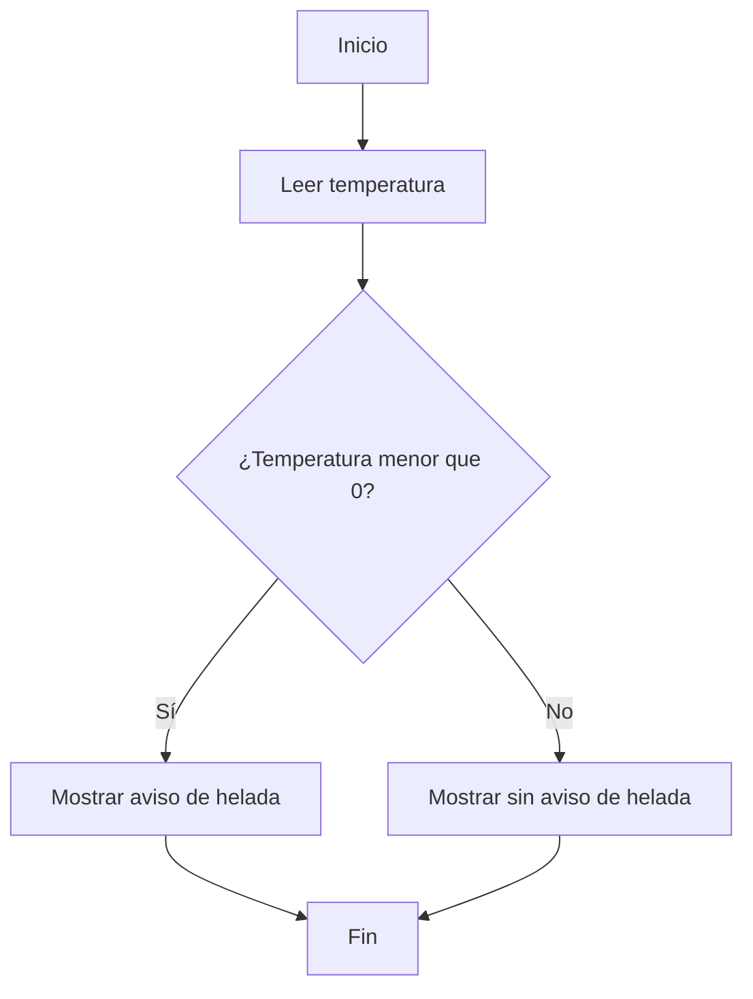

# UT5 — Estructuras de decisión

Hasta ahora hemos creado programas que muestran información, realizan cálculos y reciben datos por teclado. Pero muchos programas necesitan **tomar decisiones**: no siempre deben ejecutar las mismas instrucciones.

Por ejemplo, un programa puede mostrar un aviso cuando la temperatura baja de cero o decidir qué mensaje enseñar según una respuesta del usuario. En esta unidad aprenderemos a construir esas decisiones en **Java 21**.

Además, conoceremos brevemente `Math.random()`, que nos permitirá introducir el azar en pequeños juegos y simulaciones.

## 1️⃣ ¿Qué vamos a aprender?

Al terminar esta unidad podrás:

- Comprender qué es una **condición** y cuándo su resultado es `true` o `false`.
- Comparar valores mediante operadores relacionales.
- Combinar condiciones con operadores lógicos.
- Utilizar `if` para ejecutar instrucciones solo cuando se cumple una condición.
- Elegir entre dos alternativas mediante `if/else`.
- Resolver decisiones con varias posibilidades usando `else if`.
- Seleccionar opciones con `switch`.
- Generar números aleatorios sencillos con `Math.random()` para crear pequeños juegos.
- Probar distintas entradas y comprobar si las decisiones funcionan correctamente.

## 2️⃣ De las instrucciones secuenciales a las decisiones

Hasta ahora, muchos de nuestros programas han seguido un recorrido lineal:

1. Pedir un dato.
2. Realizar una operación.
3. Mostrar el resultado.

En una **estructura de decisión**, el programa comprueba una condición y elige qué camino seguir.

:::info[¿Qué es una estructura de decisión?]

Es una estructura de control que permite ejecutar instrucciones diferentes según el resultado de una condición. Una condición puede ser **verdadera** (`true`) o **falsa** (`false`).

:::

No hace falta memorizar el diagrama: lo importante es entender que **los datos pueden cambiar el recorrido del programa**.

## 3️⃣ ¿Qué estructuras utilizaremos?

| Estructura | ¿Para qué sirve? |
| --- | --- |
| `if` | Ejecutar instrucciones cuando una condición es verdadera. |
| `if/else` | Elegir entre dos caminos. |
| `else if` | Comprobar varias condiciones en orden. |
| `switch` | Seleccionar una opción entre varios casos. |

También utilizaremos operadores de comparación y operadores lógicos para expresar las condiciones.

## 4️⃣ Un poco de azar: `Math.random()`

Algunos programas necesitan resultados que no sean siempre iguales. Por ejemplo, un dado virtual, una moneda o la elección del ordenador en un juego.

Java dispone de `Math.random()`, que genera un número decimal **desde 0 incluido hasta 1 excluido**. Más adelante veremos cómo convertirlo en números enteros dentro de un intervalo, como los valores del 1 al 6 de un dado.

Combinando números aleatorios y decisiones podremos construir pequeños juegos como **cara o cruz**, **piedra, papel o tijera** o **comparación de tiradas de dados**.

:::tip[¿Y si queremos jugar varias rondas?]

En esta unidad cada ejecución podrá representar una partida o tirada. Para repetir partidas sin reiniciar el programa necesitaremos **bucles**, que estudiaremos en la UT6.

:::

## 5️⃣ Organización de la unidad

| Apartado | Contenido |
| --- | --- |
| **5.1. Condiciones y operadores** | Comparaciones, valores booleanos, operadores lógicos e introducción a `Math.random()`. |
| **5.2. `if` y `else`** | Decisiones simples y alternativas. |
| **5.3. `else if`** | Decisiones múltiples y condiciones combinadas. |
| **5.4. `switch`** | Selección entre diferentes opciones. |
| **5.5. Actividades** | Problemas y pequeños juegos de dificultad progresiva. |
| **5.6. Resumen** | Conceptos esenciales y errores frecuentes. |

En los apartados teóricos encontraremos explicaciones, ejemplos y una actividad guiada resuelta. Después trabajaremos **actividades autónomas con enunciados diferentes**, para aprender a plantear soluciones propias.

## 6️⃣ ¿Qué necesitamos recordar?

Partiremos de lo aprendido en las unidades anteriores:

- Variables y tipos de datos (`int`, `double`, `String`, `boolean`).
- Operadores aritméticos y conversiones sencillas.
- Lectura de datos con `Scanner`.
- Mensajes por pantalla con `System.out.println()`.
- Estructura básica de un programa Java.

:::tip[Antes de programar]

Primero identifica los datos, después formula la pregunta que debe responder el programa y, por último, decide qué instrucciones ejecutar en cada caso.

:::

## 7️⃣ ¿Qué seremos capaces de construir?

Al finalizar la UT5 podremos crear programas que comprueben requisitos, clasifiquen resultados, seleccionen servicios, calculen importes según condiciones y desarrollen **juegos sencillos con azar**.

En la siguiente unidad, **UT6 — Estructuras repetitivas**, aprenderemos a utilizar bucles para repetir acciones y ampliar estos programas.
