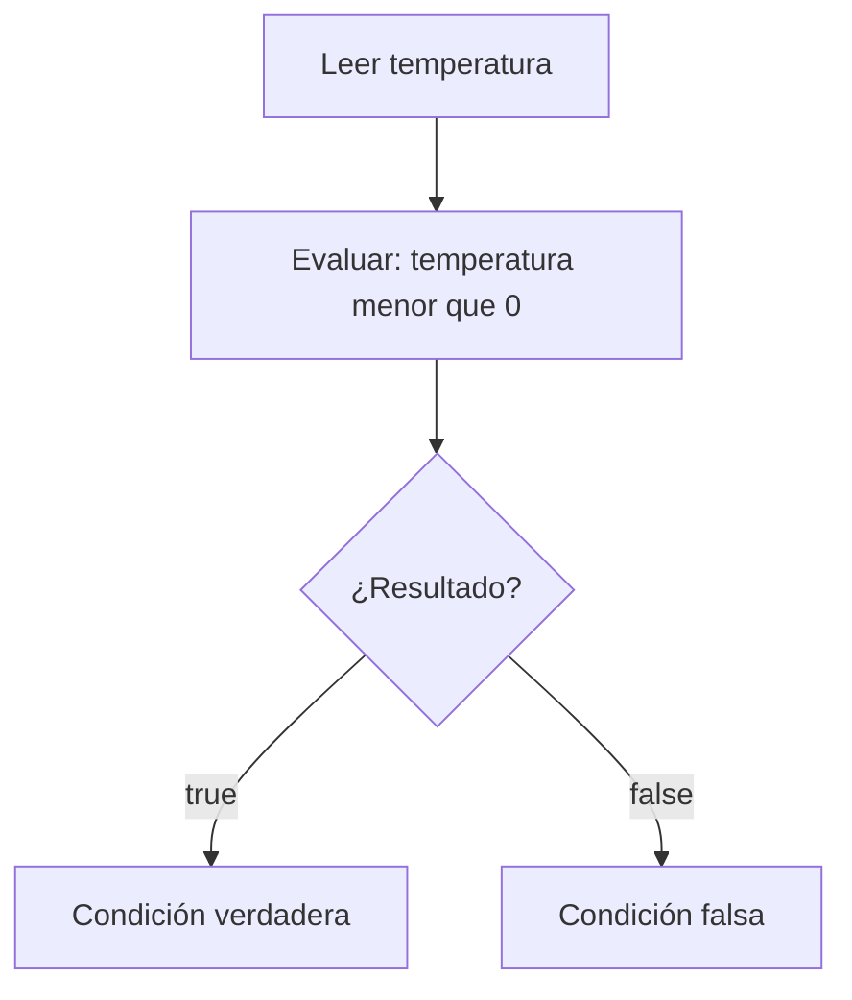

# 5.1. Condiciones y operadores

En las unidades anteriores hemos utilizado variables, operaciones y datos introducidos por teclado. Ahora necesitamos **formular preguntas que Java pueda responder con verdadero o falso**. Esas preguntas serán la base de las decisiones que estudiaremos en el siguiente apartado.

## 1️⃣ ¿Qué es una condición?

Una **condición** es una expresión cuyo resultado es uno de estos dos valores:

- `true`: verdadero.
- `false`: falso.

En Java, estos valores pertenecen al tipo `boolean`.

```java
int temperatura = -3;
boolean bajoCero = temperatura < 0;

System.out.println(bajoCero); // true
```

La expresión `temperatura < 0` no muestra un mensaje ni toma una decisión por sí sola: **calcula un resultado booleano**. En el apartado 5.2 utilizaremos ese resultado con `if`.



:::info[Importante]

Una condición **no es lo mismo** que una estructura de decisión. La condición produce `true` o `false`; instrucciones como `if` decidirán qué hacer con ese resultado.

:::

## 2️⃣ Operadores de comparación

Permiten comparar dos valores. El resultado siempre es `true` o `false`.

| Operador | Significado | Ejemplo | Resultado |
| --- | --- | --- | --- |
| `>` | Mayor que | `7 > 4` | `true` |
| `<` | Menor que | `7 < 4` | `false` |
| `>=` | Mayor o igual que | `7 >= 7` | `true` |
| `<=` | Menor o igual que | `3 <= 2` | `false` |
| `==` | Igual a | `5 == 5` | `true` |
| `!=` | Distinto de | `5 != 5` | `false` |

Observa la diferencia entre **asignar** y **comparar**:

```java
int puntos = 10;                   // = asigna un valor
System.out.println(puntos == 10); // == compara: true
```

También podemos comparar variables:

```java
int velocidadActual = 80;
int velocidadLimite = 90;

System.out.println(velocidadActual <= velocidadLimite); // true
```

:::warning[Errores habituales]

- Escribir `=` cuando queremos comparar igualdad: para comparar utilizamos `==`.
- Olvidar que `>=` y `<=` incluyen el valor límite.
- Comparar el contenido de dos cadenas `String` con `==`: para comprobar si tienen el mismo texto utilizamos `.equals()`; lo veremos en ejemplos posteriores.

:::

## 3️⃣ Operadores lógicos

A veces una sola comparación no basta. Los **operadores lógicos** permiten combinar o negar condiciones.

### 🟩 AND: `&&` (y)

El resultado es verdadero **solo si las dos condiciones son verdaderas**.

```java
int hora = 11;
boolean horarioManana = hora >= 9 && hora < 14;
System.out.println(horarioManana); // true
```

| A | B | A `&&` B |
| --- | --- | --- |
| `true` | `true` | `true` |
| `true` | `false` | `false` |
| `false` | `true` | `false` |
| `false` | `false` | `false` |

### 🟧 OR: `||` (o)

El resultado es verdadero cuando **al menos una** condición es verdadera.

```java
boolean esSabado = false;
boolean esDomingo = true;
boolean esFinDeSemana = esSabado || esDomingo;
System.out.println(esFinDeSemana); // true
```

| A | B | A `\|\|` B |
| --- | --- | --- |
| `true` | `true` | `true` |
| `true` | `false` | `true` |
| `false` | `true` | `true` |
| `false` | `false` | `false` |

### 🟥 NOT: `!` (no)

Invierte el resultado de una condición.

```java
boolean luzEncendida = false;
System.out.println(!luzEncendida); // true
```

| A | `!A` |
| --- | --- |
| `true` | `false` |
| `false` | `true` |

:::tip[Leer una condición en voz alta]

`edad >= 18 && tieneEntrada` se lee: «la edad es al menos 18 **y** tiene entrada». Leer las expresiones ayuda a detectar errores de lógica.

:::

## 4️⃣ Números aleatorios con `Math.random()`

Para hacer pequeños juegos podemos utilizar `Math.random()`. Devuelve un número decimal **desde 0 incluido hasta 1 excluido**: puede valer 0, pero nunca llega a 1.

```java
double aleatorio = Math.random();
System.out.println(aleatorio);
```

Cada ejecución puede producir un resultado diferente. Para obtener un número entero entre 1 y 6:

```java
int dado = (int) (Math.random() * 6) + 1;
System.out.println(dado);
```

¿Qué ocurre aquí?

1. `Math.random()` produce un decimal desde 0 hasta menos de 1.
2. Al multiplicarlo por `6`, obtenemos un decimal desde 0 hasta menos de 6.
3. `(int)` elimina la parte decimal y deja un entero entre 0 y 5.
4. Al sumar `1`, obtenemos un entero entre 1 y 6.

| Expresión | Enteros posibles |
| --- | --- |
| `(int) (Math.random() * 2)` | 0 y 1 |
| `(int) (Math.random() * 6) + 1` | Del 1 al 6 |
| `(int) (Math.random() * 10) + 1` | Del 1 al 10 |

:::info[Una precisión]

Los resultados de `Math.random()` son **pseudoaleatorios**. Son adecuados para nuestros juegos y simulaciones sencillas, pero no para generar contraseñas o claves de seguridad.

:::

## 5️⃣ Actividad guiada y resuelta: comprobar una franja horaria

Queremos crear un programa que solicite una hora entera, de 0 a 23, y compruebe si pertenece a la franja de mañana de 9:00 a 13:59. Todavía **no utilizaremos `if`**: solo calcularemos y mostraremos el resultado de la condición.

**Archivo:** `ComprobarHorario.java`

```java
import java.util.Scanner;

public class ComprobarHorario {
    public static void main(String[] args) {
        Scanner teclado = new Scanner(System.in);

        System.out.print("Introduce la hora (0-23): ");
        int hora = teclado.nextInt();

        boolean horaValida = hora >= 0 && hora <= 23;
        boolean esManana = hora >= 9 && hora < 14;

        System.out.println("Hora dentro del intervalo 0-23: " + horaValida);
        System.out.println("Hora en la franja de mañana: " + esManana);

        teclado.close();
    }
}
```

**Ejemplo de ejecución:**

```text
Introduce la hora (0-23): 11
Hora dentro del intervalo 0-23: true
Hora en la franja de mañana: true
```

**Otra comprobación:** con la hora `17`, la primera condición será `true` y la segunda `false`.

Observa que el programa **no impide** introducir una hora incorrecta: simplemente indica si el valor está dentro del intervalo. Aprenderemos a actuar según las condiciones con `if` y `else`.

## 6️⃣ Antes de continuar

Comprueba que puedes responder estas preguntas sin ejecutar el programa:

- ¿Qué valor produce `8 >= 8`?
- ¿Qué diferencia hay entre `=` y `==`?
- ¿Cuándo es verdadero `A && B`?
- ¿Qué valores enteros puede producir `(int) (Math.random() * 4) + 1`?

En el siguiente apartado utilizaremos las condiciones para **elegir qué instrucciones ejecutar** mediante `if` y `else`.
