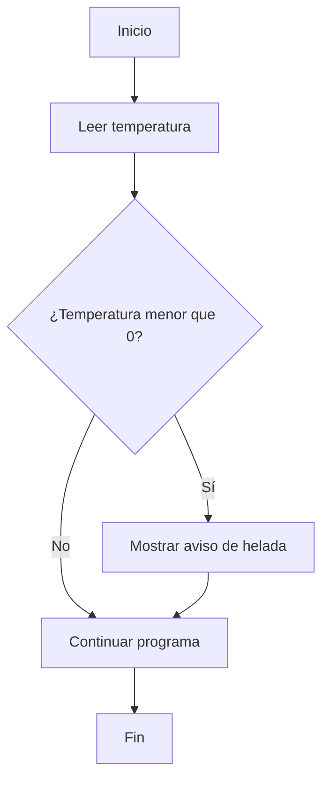
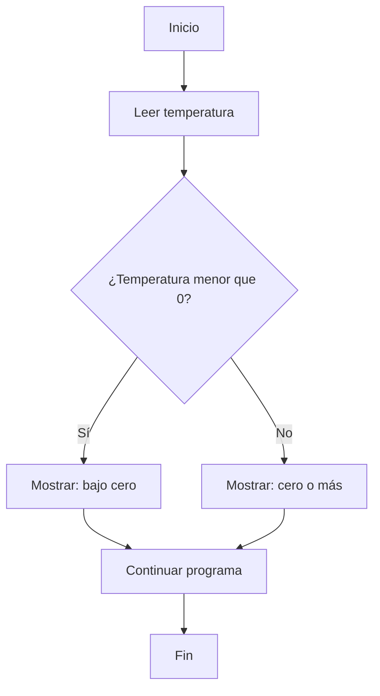

# 5.2. Estructuras `if` y `else`

En el apartado anterior aprendimos a construir **condiciones** que producen `true` o `false`. Ahora utilizaremos esos resultados para decidir **qué instrucciones se ejecutan**.

## 1️⃣ La estructura `if`: ejecutar solo si se cumple una condición

La palabra `if` significa «si». Permite ejecutar un bloque de instrucciones **únicamente cuando una condición es verdadera**.

```java
if (condicion) {
    // Instrucciones que se ejecutan si la condición es true
}
```

- La condición se escribe entre paréntesis y debe producir un valor `boolean`.
- Las llaves `{ }` delimitan el bloque que depende de la condición.
- Si la condición es `false`, Java se salta ese bloque y continúa después.

Por ejemplo, podemos mostrar un aviso cuando la temperatura está bajo cero:

```java
int temperatura = -2;

if (temperatura < 0) {
    System.out.println("Atención: riesgo de helada");
}

System.out.println("Comprobación finalizada");
```

Con `temperatura = -2`, aparecen los dos mensajes. Con `temperatura = 5`, solo aparece `Comprobación finalizada`.



:::info[Una condición no es una orden]

`temperatura < 0` solo devuelve `true` o `false`. Es `if` quien decide si se ejecuta el bloque de instrucciones.

:::

## 2️⃣ La estructura `if/else`: elegir entre dos caminos

Cuando necesitamos hacer **una cosa si se cumple la condición y otra si no se cumple**, añadimos `else` («si no»).

```java
if (condicion) {
    // Camino cuando la condición es true
} else {
    // Camino cuando la condición es false
}
```

**Solo se ejecuta uno de los dos bloques**.

```java
int temperatura = 4;

if (temperatura < 0) {
    System.out.println("Temperatura bajo cero");
} else {
    System.out.println("Temperatura igual o superior a cero");
}

System.out.println("Fin de la comprobación");
```

En este caso, se muestra `Temperatura igual o superior a cero` y después `Fin de la comprobación`.



| Temperatura | ¿`temperatura < 0`? | Mensaje elegido |
| --- | --- | --- |
| `-5` | `true` | Temperatura bajo cero |
| `0` | `false` | Temperatura igual o superior a cero |
| `12` | `false` | Temperatura igual o superior a cero |

:::tip[El valor límite importa]

Comprueba siempre qué sucede cuando el dato es exactamente igual al límite. En nuestro ejemplo, `0 < 0` es `false`.

:::

## 3️⃣ Condiciones combinadas dentro de `if`

Podemos utilizar los operadores del apartado 5.1 para tomar decisiones a partir de **más de una comparación**.

```java
int hora = 10;
boolean abierto = hora >= 9 && hora < 14;

if (abierto) {
    System.out.println("Estamos en horario de mañana");
}
```

También podemos escribir la condición directamente:

```java
if (hora >= 9 && hora < 14) {
    System.out.println("Estamos en horario de mañana");
}
```

Ambas versiones comprueban lo mismo. La primera puede resultar más legible cuando el nombre de la variable booleana explica la condición.

:::warning[Errores frecuentes]

- **Poner un punto y coma después de `if`:** `if (temperatura < 0);` termina la instrucción antes del bloque y puede provocar un comportamiento incorrecto.
- **Confundir `=` con `==`:** para comparar igualdad entre números usamos `==`.
- **Olvidar las llaves:** aunque Java permite omitirlas cuando hay una sola instrucción, en esta unidad las escribiremos siempre para evitar confusiones.
- **Escribir una condición que no sea booleana:** `if (numero)` no es válido en Java si `numero` es un `int`.

:::

## 4️⃣ Actividad guiada y resuelta: señal de temperatura

Vamos a crear un programa que pida una temperatura entera y muestre uno de estos dos mensajes:

- Si es inferior a cero: `Aviso: temperatura bajo cero`.
- En cualquier otro caso: `Temperatura sin helada`.

Después mostrará `Lectura terminada`, independientemente de la temperatura.

**Archivo:** `SenalTemperatura.java`

```java
import java.util.Scanner;

public class SenalTemperatura {
    public static void main(String[] args) {
        Scanner teclado = new Scanner(System.in);

        System.out.print("Introduce la temperatura (°C): ");
        int temperatura = teclado.nextInt();

        if (temperatura < 0) {
            System.out.println("Aviso: temperatura bajo cero");
        } else {
            System.out.println("Temperatura sin helada");
        }

        System.out.println("Lectura terminada");
        teclado.close();
    }
}
```

**Ejecución 1:**

```text
Introduce la temperatura (°C): -3
Aviso: temperatura bajo cero
Lectura terminada
```

**Ejecución 2:**

```text
Introduce la temperatura (°C): 6
Temperatura sin helada
Lectura terminada
```

**¿Cómo funciona?**

1. `Scanner` lee la temperatura introducida.
2. `if` evalúa `temperatura < 0`.
3. Se ejecuta **uno solo** de los bloques: el de `if` o el de `else`.
4. La instrucción situada después de ambos bloques se ejecuta siempre.

Para comprobar el límite, ejecuta el programa con `0`: debe mostrar `Temperatura sin helada`.

## 5️⃣ ¿Cuándo utilizar `if` y cuándo `if/else`?

| Situación | Estructura adecuada |
| --- | --- |
| Solo hay que actuar cuando se cumple una condición | `if` |
| Hay que elegir entre dos acciones excluyentes | `if/else` |

No añadas un `else` si no existe ninguna acción alternativa necesaria.

## 6️⃣ Comprueba lo aprendido

Antes de continuar, intenta responder sin ejecutar código:

- Si una condición de `if` es `false`, ¿qué sucede con las instrucciones de su bloque?
- En un `if/else`, ¿pueden ejecutarse los dos bloques en la misma evaluación?
- ¿Qué muestra el programa guiado cuando la temperatura es `0`?
- ¿Por qué `Lectura terminada` se muestra siempre?
- ¿Qué diferencia hay entre `if (numero == 5)` e `if (numero = 5)` en Java?

En el siguiente apartado veremos cómo elegir entre **más de dos posibilidades** mediante `else if`. Los ejercicios autónomos de esta unidad se reunirán en `5.5-actividades.md` y plantearán situaciones distintas de las resueltas aquí.
