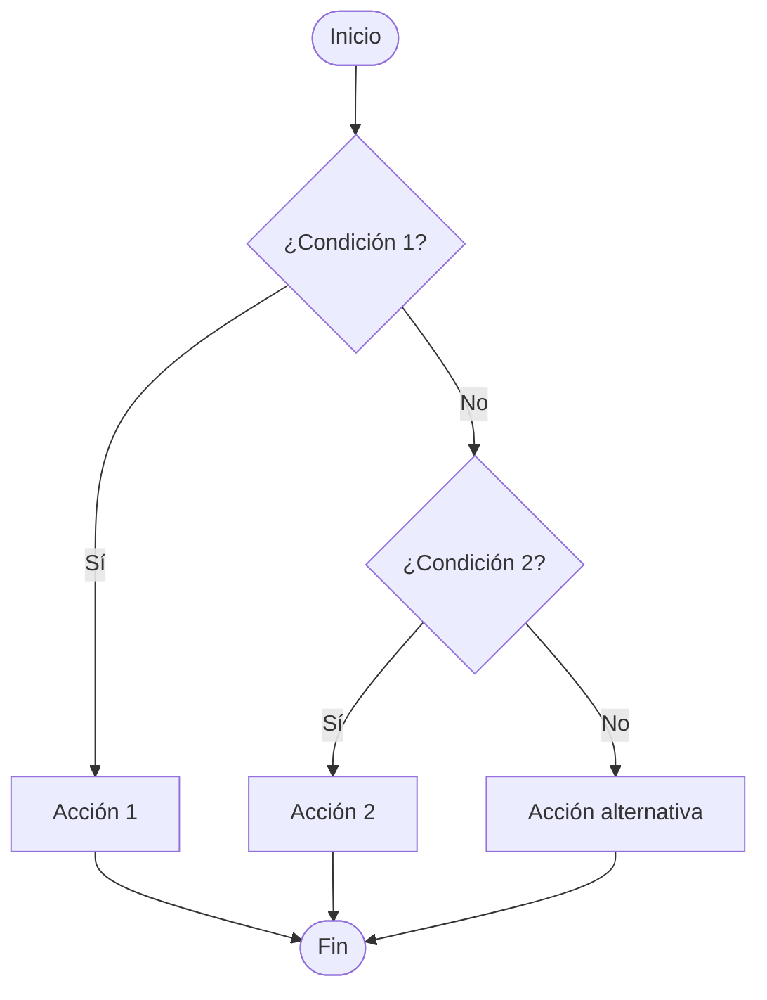

# 5.3. Decisiones múltiples con `else if`

En el apartado anterior aprendimos a utilizar `if` y `else` para ejecutar instrucciones según se cumpla o no una condición. Pero ¿qué sucede cuando existen **más de dos posibilidades**?

Por ejemplo, una temperatura puede considerarse fría, templada o cálida. Para distinguir esos casos utilizaremos `else if`.

## 1️⃣ ¿Qué es `else if`?

La estructura `else if` permite comprobar **varias condiciones en orden**. Java ejecuta únicamente el bloque correspondiente a la **primera condición verdadera**. Si ninguna se cumple, ejecuta el bloque `else`, cuando existe.

```java
if (condicion1) {
    // Se ejecuta si condicion1 es verdadera
} else if (condicion2) {
    // Se ejecuta si condicion1 es falsa y condicion2 es verdadera
} else {
    // Se ejecuta si ninguna condición anterior es verdadera
}
```

:::info[Importante]

No es obligatorio terminar con `else`, pero resulta útil cuando queremos contemplar todos los casos. Podemos añadir tantos bloques `else if` como necesitemos.

:::

### 🟩 Diagrama de flujo



Fíjate en que, cuando una condición es verdadera, **ya no se comprueban las siguientes**.

## 2️⃣ El orden de las condiciones importa

Vamos a clasificar una temperatura en tres intervalos:

- Menos de 10 °C: **fría**.
- Desde 10 °C hasta menos de 25 °C: **templada**.
- Desde 25 °C: **cálida**.

```java
int temperatura = 18;

if (temperatura < 10) {
    System.out.println("Fría");
} else if (temperatura < 25) {
    System.out.println("Templada");
} else {
    System.out.println("Cálida");
}
```

**Resultado:** `Templada`.

No hace falta escribir `temperatura >= 10` en la segunda condición: si el programa llega a ella, ya sabe que la primera (`temperatura < 10`) era falsa.

| Temperatura | Primera condición | Segunda condición | Resultado |
| --- | --- | --- | --- |
| 5 | Verdadera | No se evalúa | Fría |
| 18 | Falsa | Verdadera | Templada |
| 30 | Falsa | Falsa | Cálida |

:::warning[Error frecuente: ordenar mal los límites]

Si comprobamos primero `temperatura < 25`, una temperatura de 5 °C entrará en ese bloque y nunca llegará a la comprobación `temperatura < 10`. Antes de programar, ordena los intervalos y comprueba sus límites.

:::

## 3️⃣ Condiciones combinadas en decisiones múltiples

Podemos utilizar los operadores lógicos estudiados en el apartado 5.1 para comprobar más de un requisito en una misma condición.

Por ejemplo, este fragmento distingue tres mensajes según la hora:

```java
int hora = 14;

if (hora < 0 || hora > 23) {
    System.out.println("Hora no válida");
} else if (hora >= 6 && hora < 12) {
    System.out.println("Mañana");
} else if (hora >= 12 && hora < 20) {
    System.out.println("Tarde");
} else {
    System.out.println("Noche o madrugada");
}
```

**Resultado:** `Tarde`.

Aquí usamos `||` para detectar valores fuera del intervalo válido y `&&` para exigir que se cumplan dos límites simultáneamente.

:::tip[Antes de escribir el código]

Identifica todas las posibilidades, decide sus límites y revisa qué ocurrirá justo en los valores de frontera. En el ejemplo anterior conviene probar las horas 0, 6, 12, 20 y 23, además de valores no válidos como -1 y 24.

:::

## 4️⃣ Diferencia entre varios `if` y una cadena `if / else if`

Estas dos construcciones **no significan lo mismo**:

```java
int numero = 12;

if (numero > 0) {
    System.out.println("Positivo");
}
if (numero > 10) {
    System.out.println("Mayor que diez");
}
```

Aquí se muestran **dos mensajes**, porque cada `if` se evalúa de forma independiente.

```java
int numero = 12;

if (numero > 0) {
    System.out.println("Positivo");
} else if (numero > 10) {
    System.out.println("Mayor que diez");
}
```

Aquí solo aparece `Positivo`: al cumplirse la primera condición, Java no comprueba la segunda.

**Regla práctica:** utiliza varios `if` independientes si pueden ejecutarse varias acciones; utiliza `if / else if` si necesitas escoger **una sola alternativa**.

## 5️⃣ Actividad guiada resuelta: estado de la temperatura

Vamos a construir un programa que solicite una temperatura y muestre una descripción según estos intervalos:

| Temperatura | Mensaje |
| --- | --- |
| Menor que 0 °C | Bajo cero |
| De 0 °C a menos de 15 °C | Fresca |
| De 15 °C a menos de 30 °C | Agradable |
| Desde 30 °C | Muy calurosa |

### 🟩 Código completo

Guarda el archivo como `EstadoTemperatura.java`.

```java
import java.util.Scanner;

public class EstadoTemperatura {
    public static void main(String[] args) {
        Scanner teclado = new Scanner(System.in);

        System.out.print("Introduce la temperatura en °C: ");
        double temperatura = teclado.nextDouble();

        if (temperatura < 0) {
            System.out.println("Bajo cero");
        } else if (temperatura < 15) {
            System.out.println("Fresca");
        } else if (temperatura < 30) {
            System.out.println("Agradable");
        } else {
            System.out.println("Muy calurosa");
        }

        teclado.close();
    }
}
```

### 🟧 Cómo funciona

1. El programa lee un número decimal con `Scanner`.
2. Comprueba si la temperatura es menor que cero.
3. Si no lo es, comprueba si es menor que 15.
4. Si tampoco se cumple, comprueba si es menor que 30.
5. Si ninguna condición anterior es verdadera, ejecuta el `else`.

Solo aparece **uno de los cuatro mensajes**.

### 🟪 Comprobación con diferentes entradas

| Entrada | Salida esperada |
| --- | --- |
| -3 | Bajo cero |
| 0 | Fresca |
| 14.5 | Fresca |
| 15 | Agradable |
| 29.9 | Agradable |
| 30 | Muy calurosa |

## 6️⃣ Errores frecuentes y comprobación

- **Solapar intervalos sin revisar el orden:** una condición demasiado general puede impedir que se evalúen las siguientes.
- **Confundir `if` independientes con `else if`:** los primeros pueden ejecutar varios bloques; una cadena `else if` selecciona uno como máximo.
- **Olvidar los límites:** prueba siempre los valores justo antes, en y justo después de cada frontera.
- **Escribir `else` con condición:** `else` no lleva condición; para comprobar otra, utiliza `else if`.
- **Utilizar `=` para comparar:** en Java, la comparación de igualdad se escribe `==`.

:::info[Comprueba que lo has entendido]

1. ¿Qué sucede si la primera condición de una cadena `if / else if` es verdadera?
2. ¿Puede ejecutarse más de un bloque de una misma cadena?
3. ¿Qué diferencia hay entre utilizar tres `if` independientes y una cadena con `if` y dos `else if`?
4. ¿Por qué conviene probar exactamente los valores límite?
5. ¿Es obligatorio incluir un `else` final?

:::

En el siguiente apartado conoceremos `switch`, otra estructura útil cuando queremos seleccionar entre varias opciones concretas.
