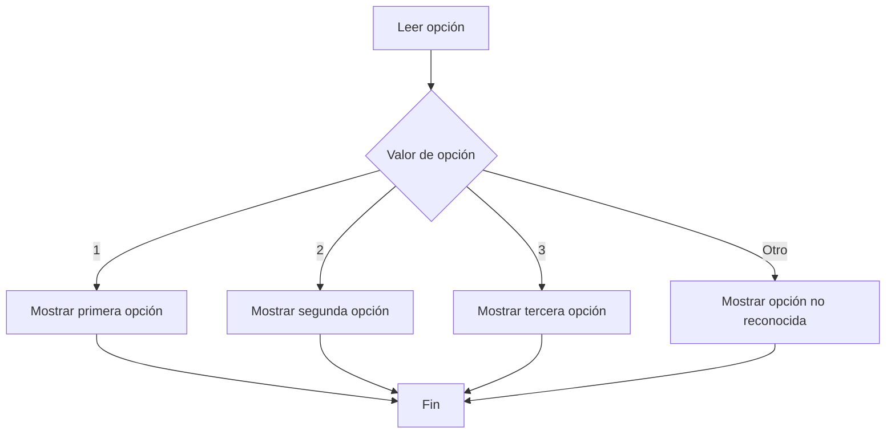

# 5.4. Estructura `switch`

En los apartados anteriores hemos aprendido a tomar decisiones con `if`, `else` y `else if`. Cuando necesitamos elegir una acción entre **varios valores concretos** de una misma variable, Java también ofrece `switch`.

## 1️⃣ ¿Qué es `switch`?

`switch` compara el valor de una expresión con distintas opciones (`case`). Cuando encuentra una coincidencia, ejecuta las instrucciones correspondientes.

Por ejemplo, si un programa recibe un número del 1 al 3, puede mostrar un mensaje distinto para cada valor.

```java
int opcion = 2;

switch (opcion) {
    case 1:
        System.out.println("Primera opción");
        break;
    case 2:
        System.out.println("Segunda opción");
        break;
    case 3:
        System.out.println("Tercera opción");
        break;
    default:
        System.out.println("Opción no reconocida");
}
```

**Resultado:** `Segunda opción`.

- `switch (opcion)` indica el valor que queremos comprobar.
- `case` identifica cada valor posible.
- `break` sale del `switch` al terminar ese caso.
- `default` se ejecuta si no coincide ningún `case` (es opcional, pero recomendable).

:::info[Una diferencia importante]

`switch` es útil cuando comparamos **valores concretos**. Para condiciones como `edad >= 18` o `temperatura < 0`, normalmente utilizaremos `if`.

:::

## 2️⃣ ¿Cómo funciona? Diagrama de flujo



El programa **selecciona una ruta** según el valor recibido. No necesita recorrer todas las alternativas como instrucciones independientes.

## 3️⃣ La importancia de `break` y `default`

En la forma clásica de `switch`, `break` evita que el programa continúe ejecutando instrucciones de los casos siguientes.

```java
int opcion = 1;

switch (opcion) {
    case 1:
        System.out.println("Uno");
    case 2:
        System.out.println("Dos");
        break;
    default:
        System.out.println("Otro");
}
```

**Resultado:**

```text
Uno
Dos
```

Esto sucede porque falta `break` después de `case 1`. Este comportamiento se llama *fall-through* (continuación al caso siguiente).

:::warning[Error frecuente]

Olvidar `break` en un `switch` clásico puede provocar que se ejecuten instrucciones de más de un caso. Comprueba siempre dónde termina cada alternativa.

:::

`default` permite responder a valores inesperados, como introducir `9` cuando solo se admiten las opciones 1, 2 y 3.

## 4️⃣ `switch` con `String` y sintaxis moderna

También podemos utilizar cadenas de texto:

```java
String color = "azul";

switch (color) {
    case "rojo":
        System.out.println("Color cálido");
        break;
    case "azul":
        System.out.println("Color frío");
        break;
    default:
        System.out.println("Color no clasificado");
}
```

Java 21 permite una sintaxis más breve con flechas `->`:

```java
int opcion = 2;

switch (opcion) {
    case 1 -> System.out.println("Primera opción");
    case 2 -> System.out.println("Segunda opción");
    case 3 -> System.out.println("Tercera opción");
    default -> System.out.println("Opción no reconocida");
}
```

En esta variante **no necesitamos `break`** para impedir que se ejecuten los demás casos. En esta unidad aprenderemos a reconocer ambas formas, aunque usaremos principalmente la forma clásica para entender su funcionamiento.

## 5️⃣ Actividad guiada resuelta: elegir una figura geométrica

Vamos a crear un programa que pida un número y muestre el nombre de una figura: 1 para círculo, 2 para cuadrado y 3 para triángulo. Cualquier otro número se considerará incorrecto.

**Archivo:** `ElegirFigura.java`

```java
import java.util.Scanner;

public class ElegirFigura {
    public static void main(String[] args) {
        Scanner teclado = new Scanner(System.in);

        System.out.print("Elige una figura (1, 2 o 3): ");
        int opcion = teclado.nextInt();

        switch (opcion) {
            case 1:
                System.out.println("Has elegido un círculo.");
                break;
            case 2:
                System.out.println("Has elegido un cuadrado.");
                break;
            case 3:
                System.out.println("Has elegido un triángulo.");
                break;
            default:
                System.out.println("La opción no es válida.");
        }

        teclado.close();
    }
}
```

**Comprueba estas ejecuciones:**

| Entrada | Salida esperada |
| --- | --- |
| `1` | Has elegido un círculo. |
| `3` | Has elegido un triángulo. |
| `8` | La opción no es válida. |

**¿Qué ocurre paso a paso?**

1. `Scanner` lee un número entero.
2. `switch` compara ese número con los valores de cada `case`.
3. Se muestra el mensaje correspondiente.
4. `break` evita ejecutar los demás casos.
5. Si no hay coincidencia, se ejecuta `default`.

Este ejemplo solo sirve para comprender la selección de opciones; los problemas de la página de actividades utilizarán contextos y requisitos diferentes.

## 6️⃣ ¿Cuándo utilizar `if` y cuándo `switch`?

| Situación | Estructura adecuada |
| --- | --- |
| Comprobar si un número es mayor que otro | `if` |
| Comprobar varias condiciones con `&&` o `||` | `if` / `else if` |
| Elegir entre opciones numeradas con valores fijos | `switch` |
| Actuar según un texto que coincide exactamente con una opción | `switch` |
| Clasificar un valor por intervalos | `if` / `else if` |

:::tip[Recuerda]

La estructura adecuada depende del problema. No se trata de utilizar siempre la instrucción más nueva, sino la que hace el código más claro y fácil de comprobar.

:::

## 7️⃣ Comprueba que lo has entendido

Antes de pasar a las actividades autónomas, responde:

1. ¿Qué diferencia existe entre `case` y `default`?
2. ¿Qué puede ocurrir si olvidamos `break` en la sintaxis clásica?
3. ¿Podemos utilizar `switch` con una variable `String`?
4. ¿Qué estructura elegirías para comprobar si una temperatura supera los 30 grados? ¿Por qué?
5. ¿Qué ventaja tiene la sintaxis `case 1 ->` respecto a la forma clásica?

En el siguiente apartado pondremos en práctica las estructuras de decisión mediante **actividades de dificultad progresiva**, incluidos pequeños juegos con números aleatorios.
