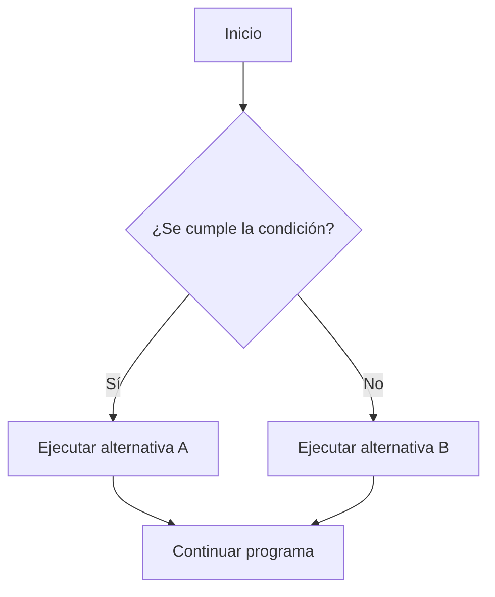

# 5.6. Resumen de estructuras de decisión

En esta unidad hemos aprendido a crear programas que **eligen qué instrucciones ejecutar** según los datos y las condiciones. Este resumen sirve para repasar la sintaxis, elegir la estructura adecuada y comprobar nuestros programas.

## 1️⃣ Condiciones y comparaciones

Una **condición** es una expresión cuyo resultado es `true` (verdadero) o `false` (falso). En Java podemos guardar ese resultado en una variable `boolean`.

```java
int temperatura = 4;
boolean haceFrio = temperatura < 10;
System.out.println(haceFrio); // true
```

| Operador | Significado | Ejemplo |
| --- | --- | --- |
| `==` | Igual a | `a == b` |
| `!=` | Distinto de | `a != b` |
| `>` | Mayor que | `a > b` |
| `<` | Menor que | `a < b` |
| `>=` | Mayor o igual que | `a >= b` |
| `<=` | Menor o igual que | `a <= b` |

:::warning[No confundas `=` y `==`]

`=` asigna un valor a una variable; `==` compara dos valores. Para comparar el contenido de dos cadenas `String`, utiliza `.equals()`.

:::

## 2️⃣ Operadores lógicos

Permiten combinar o negar condiciones.

| Operador | Significado | ¿Cuándo da `true`? |
| --- | --- | --- |
| `&&` | Y | Cuando ambas condiciones son verdaderas |
| `\|\|` | O | Cuando al menos una es verdadera |
| `!` | NO | Cuando la condición negada es falsa |

```java
int hora = 11;
boolean abierto = hora >= 9 && hora < 14;
System.out.println(abierto); // true
```

**Tabla de verdad de `&&` y `||`:**

| A | B | `A && B` | `A \|\| B` |
| --- | --- | --- | --- |
| `true` | `true` | `true` | `true` |
| `true` | `false` | `false` | `true` |
| `false` | `true` | `false` | `true` |
| `false` | `false` | `false` | `false` |

## 3️⃣ Las estructuras de decisión

| Estructura | Cuándo utilizarla |
| --- | --- |
| `if` | Ejecutar instrucciones solo si se cumple una condición |
| `if/else` | Elegir entre dos caminos |
| `if/else if/else` | Comprobar varias condiciones en orden y ejecutar una alternativa |
| `switch` | Elegir entre valores concretos de una expresión |

### 🟩 `if`: una condición

```java
if (temperatura < 0) {
    System.out.println("Temperatura bajo cero");
}
```

### 🟧 `if/else`: dos alternativas

```java
if (temperatura < 0) {
    System.out.println("Bajo cero");
} else {
    System.out.println("Cero o más");
}
```

### 🟥 `else if`: varias condiciones

```java
if (temperatura < 0) {
    System.out.println("Bajo cero");
} else if (temperatura < 20) {
    System.out.println("Menos de 20 grados");
} else {
    System.out.println("20 grados o más");
}
```

En una cadena `if / else if / else`, **se ejecuta únicamente la primera rama cuya condición sea verdadera**. Por eso, el orden importa.

### 🟪 `switch`: opciones concretas

```java
int opcion = 2;

switch (opcion) {
    case 1:
        System.out.println("Primera opción");
        break;
    case 2:
        System.out.println("Segunda opción");
        break;
    default:
        System.out.println("Opción desconocida");
}
```

En el `switch` clásico, `break` evita que se siga ejecutando el código de los casos posteriores. `default` atiende los valores que no coinciden con ningún `case`.

En Java 21 también podemos escribir:

```java
switch (opcion) {
    case 1 -> System.out.println("Primera opción");
    case 2 -> System.out.println("Segunda opción");
    default -> System.out.println("Opción desconocida");
}
```

Con esta sintaxis de flechas **no hace falta `break`**.

## 4️⃣ Repaso visual: elegir un camino



Este diagrama representa una decisión con dos alternativas (`if/else`). Si solo necesitamos actuar cuando la condición sea verdadera, podemos utilizar únicamente `if`.

## 5️⃣ Números aleatorios con `Math.random()`

`Math.random()` devuelve un `double` entre **0 incluido y 1 excluido**. Podemos transformarlo en un entero para simular sorteos y juegos.

```java
int dado = (int) (Math.random() * 6) + 1;
System.out.println(dado); // Un entero entre 1 y 6
```

| Expresión | Resultados posibles |
| --- | --- |
| `(int) (Math.random() * 2)` | 0 o 1 |
| `(int) (Math.random() * 6) + 1` | Del 1 al 6 |
| `(int) (Math.random() * 10) + 1` | Del 1 al 10 |

El resultado puede cambiar en cada ejecución. Combinando números aleatorios y decisiones podemos programar juegos como cara o cruz, piedra-papel-tijera o duelo de dados.

## 6️⃣ Errores frecuentes

| Error | Qué debemos revisar |
| --- | --- |
| Escribir `=` en vez de `==` | Diferenciar asignación y comparación |
| Comparar textos con `==` | Usar `.equals()` para comparar su contenido |
| Ordenar mal los `else if` | Comprobar primero las condiciones que corresponda priorizar |
| Escribir varios `if` cuando solo debe elegirse una opción | Considerar `if / else if / else` |
| Olvidar las llaves `{ }` | Delimitar claramente los bloques de instrucciones |
| Olvidar `break` en un `switch` clásico | Evitar ejecutar también los casos siguientes |
| No contemplar valores inesperados | Utilizar `else` o `default` cuando proceda |
| Probar un solo dato | Comprobar casos normales, límites y valores no previstos |

:::tip[Comprobar antes de entregar]

Prueba cada camino posible de tu programa. Si una condición utiliza `>= 18`, comprueba al menos los valores **17, 18 y 19**: así podrás detectar errores en el límite.

:::

## 7️⃣ ¿Qué hemos aprendido y qué viene después?

Ya sabemos combinar **entrada de datos con `Scanner`**, variables, operadores y decisiones para crear programas interactivos. También podemos añadir resultados aleatorios para que algunos programas funcionen como pequeños juegos.

Hasta ahora, cada decisión se comprueba cuando el programa llega a ella. En la **UT6 — Estructuras repetitivas** aprenderemos a utilizar `while`, `do-while` y `for` para repetir instrucciones, por ejemplo, permitir varios intentos en un juego o volver a mostrar un menú.
